#  Dumpie

**PHP debug output right inside PhpStorm.**

`dump()`, `dd()`, log records, SQL queries, exceptions and `ray()` calls show up in a tool window next to your code,
each with a link to the line that produced it. No separate app, no extra browser tab, no scrolling through
`laravel.log`.

**Website:** [sadonsergey.github.io/dumpie](https://sadonsergey.github.io/dumpie/) ·
**JetBrains Marketplace:** [Dumpie](https://plugins.jetbrains.com/plugin/35423-dumpie)

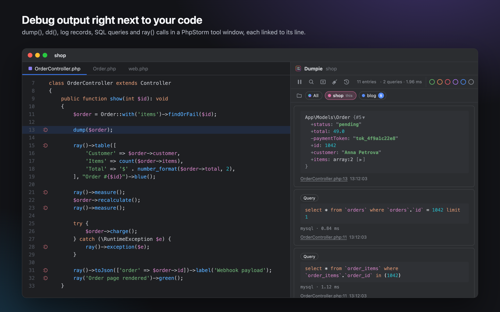

## Already using spatie/ray? Keep your code, skip the paid desktop app

Dumpie speaks the same protocol and listens on the same port, `23517`. Projects with `spatie/ray` or
`spatie/laravel-ray` send their output to PhpStorm as they are: no code changes, no extra package, no license to buy.
Free and open source.

```php
ray($order)->green();
ray()->showQueries();
ray()->measure();
ray()->pause();
```

- **What shows up:** tables, queries, events, jobs, mails, models, exceptions, `measure()`, `pause()`, colors, labels
  and screens.
- **Plus what only an IDE can do:** gutter icons on the lines that sent output, links that open the file, a session per
  project, dumps copied as PHP code.
- **Switching:** both apps use port `23517`. Quit the desktop app, or give Dumpie its own port and move projects one at a
  time, see [Projects with spatie/ray](#projects-with-spatieray).

## Many projects. Many IDEs. Nothing mixes up.

Real work means several projects open at once — often in different IDEs. Dumpie keeps every project's output in
its own session and delivers it to the window that has the project open.

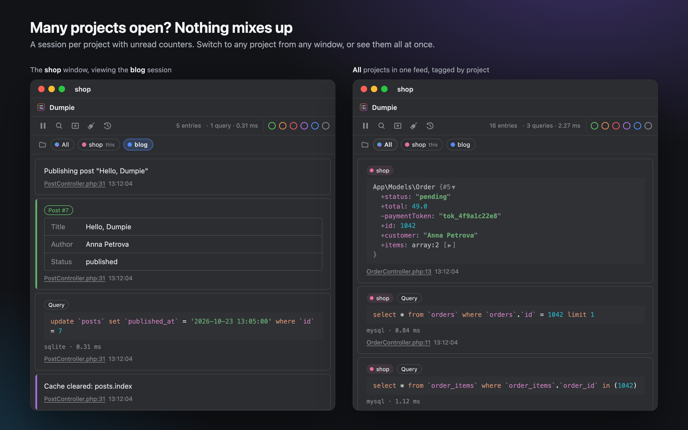

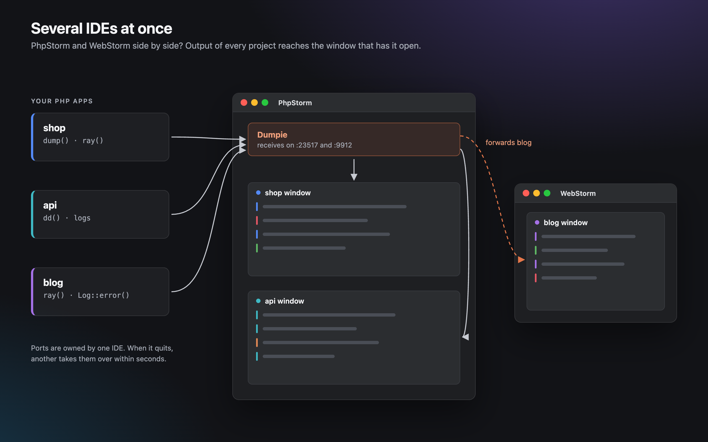

- **A session per project.** `shop` never sees `blog`'s dumps, even when both run at the same time.
- **Switch or see everything.** The project chips under the toolbar open any open project's session from any
  window, or **All projects**: one feed with every entry tagged by its project.
- **Unread counters.** Each project chip shows how many new entries arrived while you were looking at another
  session.
- **Across IDEs.** PhpStorm and WebStorm (or two IDE versions) open side by side? The IDE that receives the output
  forwards it to the one that has the project open. `ray()->pause()` can be continued from either.
- **No restart when IDEs come and go.** Quit the IDE that owned the ports, and another one takes them over within
  seconds.
- **Files open in the right window.** Clicking `File.php:42` of another session opens it in that project's window.

## Contents

- [Already using spatie/ray?](#already-using-spatieray-keep-your-code-skip-the-paid-desktop-app)
- [Many projects. Many IDEs.](#many-projects-many-ides-nothing-mixes-up)
- [Features](#features)
- [Installation](#installation)
- [Quick start](#quick-start)
- [Using the tool window](#using-the-tool-window)
- [Settings](#settings)
- [Troubleshooting](#troubleshooting)
- [Building from source](#building-from-source)
- [Contributing](#contributing)
- [Support the project](#support-the-project)
- [License](#license)

## Features

- **`dump()` and `dd()` without extra packages.** Any project with `symfony/var-dumper` (Laravel, Symfony and most
  modern PHP apps) sends dumps to the IDE after adding one line to `.env`. Dumps stay interactive: nested arrays and
  objects expand and collapse, colors follow your editor scheme.
- **Log files.** New records from `storage/logs/*.log` (Laravel) or `var/log/*.log` (Symfony) appear as they are
  written, colored by level, with the stack trace attached.
- **Works with `spatie/ray`.** Projects that already use `spatie/ray` or `spatie/laravel-ray` work as they are:
  tables, queries, events, jobs, mails, models, exceptions, measurements, `pause()`, colors, labels and screens.
- **Jump to code.** Every entry links to its file and line. Docker paths such as `/var/www/html/app/...` are matched
  to your project automatically. And back: an icon in the editor gutter marks the lines that sent output.
- **SQL insights.** Repeated queries (possible N+1) and slow queries are marked; the toolbar shows how many queries a
  screen ran and their total time.
- **One session per project, several IDEs at once.** See [above](#many-projects-many-ides-nothing-mixes-up).
- **Guided setup.** When a project cannot send anything yet, the empty tool window shows what is missing, with an
  **Add to .env** button and ready-to-copy commands.
- **Made for reading.** Highlighted code, SQL and JSON, folded stack traces. Filter by color, search, pause the feed,
  collapse entries, copy any entry as a Markdown code block or open it in an editor tab.
- **Nothing lost.** Whatever Clear removes goes to an archive and can be restored to its project.
- **Follows the IDE.** Light and dark themes, UI and editor fonts come from your IDE settings.
- **Local only.** Dumpie listens on `127.0.0.1`; nothing leaves your machine.

## Installation

Requires **PhpStorm 2024.3 or newer**. Dumpie also installs in **WebStorm 2024.3 or newer**: every build is checked
with the JetBrains Plugin Verifier against PhpStorm and WebStorm 2024.3–2026.2.

1. Open **Settings | Plugins | Marketplace**, search for **Dumpie** and press **Install**, or install it from its
   [JetBrains Marketplace page](https://plugins.jetbrains.com/plugin/35423-dumpie).
2. Open your project. Dumpie inspects it and turns on the sources it supports.

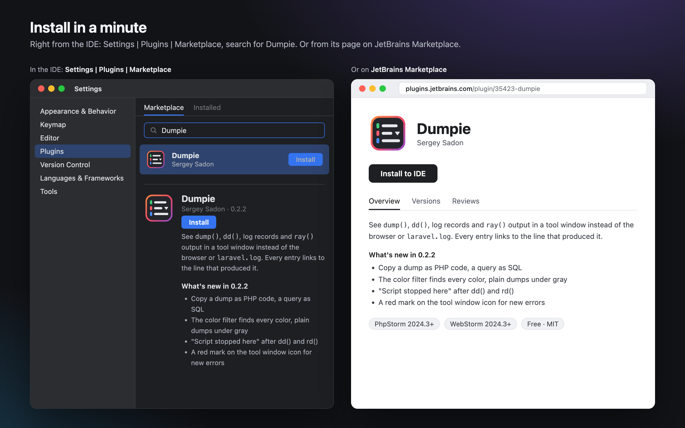

Prefer a file? Get `dumpie-<version>.zip` from the [Releases](https://github.com/sadonsergey/dumpie/releases) page (or
build it yourself, see [Building from source](#building-from-source)), then **Settings | Plugins | ⚙ | Install Plugin
from Disk…**

## Quick start

Open the **Dumpie** tool window: if the project cannot send anything yet (no `spatie/ray` and no `VAR_DUMPER_FORMAT`
in `.env`), it shows what is missing and offers the fix right there. The same information is in
**Settings | Tools | Dumpie**.

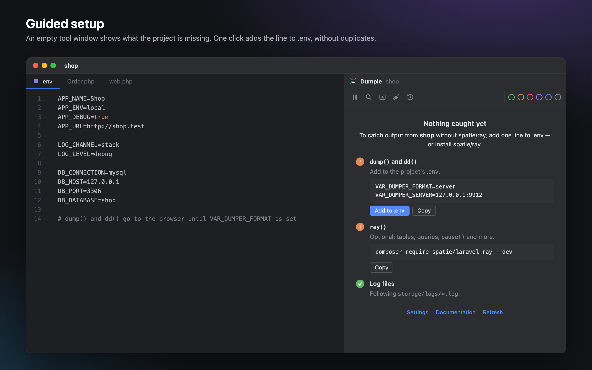

### dump() and dd()

Add to the project's `.env`, or press **Add to .env** in the tool window or on the settings page (it never adds a
key twice and updates an existing value instead):

```dotenv
VAR_DUMPER_FORMAT=server
VAR_DUMPER_SERVER=127.0.0.1:9912
```

Call `dump($order)` anywhere: the dump appears in the Dumpie tool window instead of the page or the console.
When the IDE is closed, PHP prints dumps as usual.

> Laravel reads `.env` only when the configuration is not cached. After `php artisan config:cache`, run
> `php artisan config:clear` or define the variables in the server environment.

### Log files

Nothing to configure. Dumpie follows the log directory it found in the project (`storage/logs/*.log` or
`var/log/*.log`) and shows records written after the project was opened. The paths can be changed in the settings.

### Projects with spatie/ray

Nothing to configure either: `ray()` sends to `localhost:23517` by default, and that is where Dumpie listens.

```php
ray('Hello from Dumpie')->green();
ray()->table(['Customer' => $order->customer, 'Total' => $order->total], 'Order');
ray()->showQueries();
```

> **Quit the Ray desktop app.** Ray and Dumpie both listen on port `23517`, and only one application can use a port
> at a time: while Ray is running, `ray()` output goes to Ray and Dumpie receives nothing from `ray()`.
> `dump()`, `dd()` and log files are not affected — they reach Dumpie even with Ray open.

**Keeping Ray and Dumpie side by side.** Give Dumpie its own port in **Settings | Tools | Dumpie**, for example
`23518`, and point the projects that should report to Dumpie at it. Every project sends `ray()` output to one port
only, so the other projects keep reporting to Ray:

```dotenv
RAY_PORT=23518   # spatie/laravel-ray, read by the published config/ray.php
```

For plain `spatie/ray`, set `'port' => 23518` in the project's `ray.php`.

### Docker and Laravel Sail

PHP inside a container reaches the IDE through `host.docker.internal`:

```dotenv
VAR_DUMPER_SERVER=host.docker.internal:9912
RAY_HOST=host.docker.internal   # spatie/laravel-ray, read by the published config/ray.php
```

File links work without extra setup: a container path is matched to the project by its longest existing suffix.

## Using the tool window

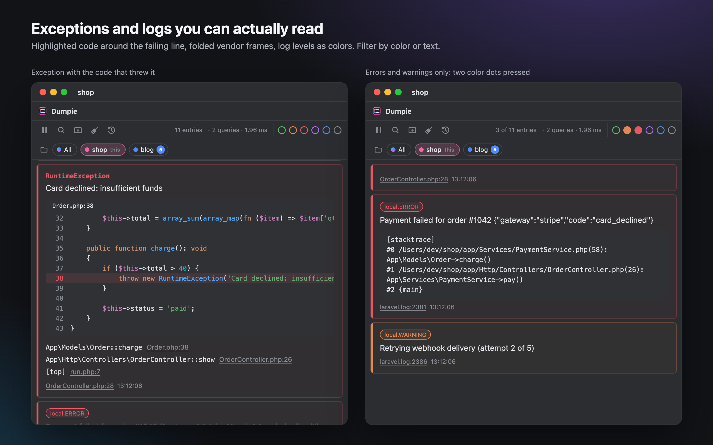

The panel follows the IDE theme and fonts:

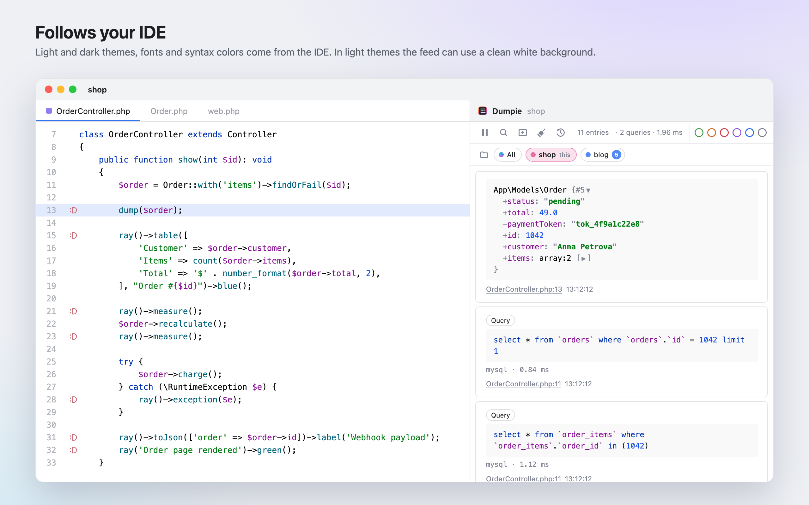

- **Open the source**: click `File.php:42` under an entry.
- **Filter**: click color dots (several at once), or the search icon to filter by text; `Esc` clears the search.
  Every color an entry shows counts: `ray()` colors, log levels, exceptions (red), **Slow** (red) and **Repeated**
  (orange) queries. Entries without a color, such as plain dumps and info log records, are found under gray.
- **Pause**: the pause button freezes the feed; new entries are counted and shown when you resume.
  A `ray()->pause()` call is never held back, so the script does not hang.
- **Collapse**: click the colored left edge of an entry.
- **Copy**: hover an entry and press **Copy text** for its content as plain text, or **Copy as Markdown** for
  fenced blocks (```` ```php ````, ```` ```sql ````, ```` ```json ````).
- **Copy code**: hover a dump, query or JSON block and press **Copy as PHP** / **Copy SQL** / **Copy JSON** in its corner. Dumps become PHP code ready
  to paste (`['id' => 1042, 'status' => 'pending']`; objects as arrays of their properties), queries come with their
  values in place of `?`.
- **Open in editor**: the icon next to Copy opens the entry in an editor tab, handy for big dumps and JSON.
- **`dd()`**: the last dump of a `dd()` (or `ray()` with `rd()` / `->die()`) is marked **Script stopped here**.
- **Errors while the tool window is hidden**: its icon gets a red mark; opening it scrolls to the last error.
- **Screens**: `ray()->newScreen('Checkout')` starts a fresh screen; earlier screens stay in the screen selector. The
  `×` on the active tab closes a screen.
- **Sessions**: with several projects open, the project bar under the toolbar switches between their sessions or
  shows **All**. Every project keeps its color; a new tool window always starts with its own project.
- **Clear**: the broom icon clears the session you are looking at. The clock icon lists what was cleared;
  **Restore** puts it back into the project it came from.
- **Gutter icons**: lines that produced output get a Dumpie icon in the editor gutter. Hover it to see what the line
  sent, click it to jump to the entry.
- **SQL**: queries that ran 3 or more times with different values are marked **Repeated** (possible N+1), queries over
  the threshold (100 ms by default) are marked **Slow**.

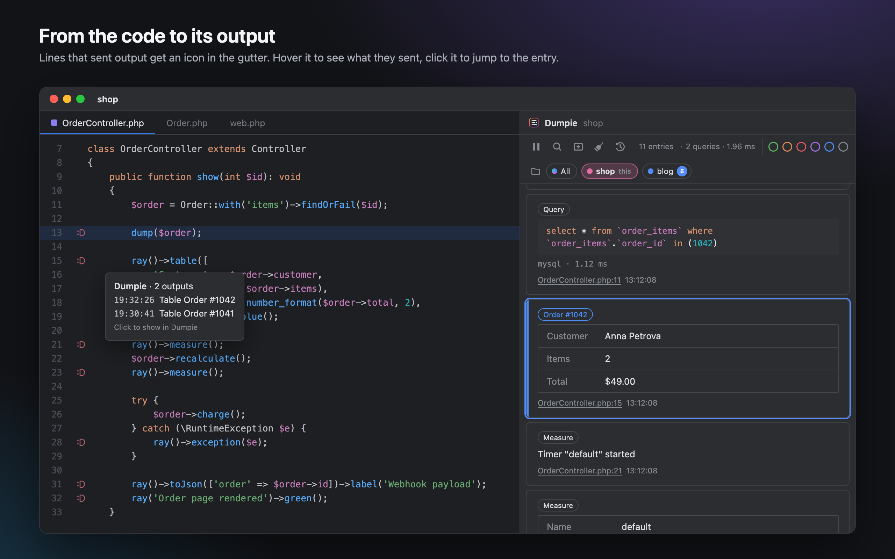

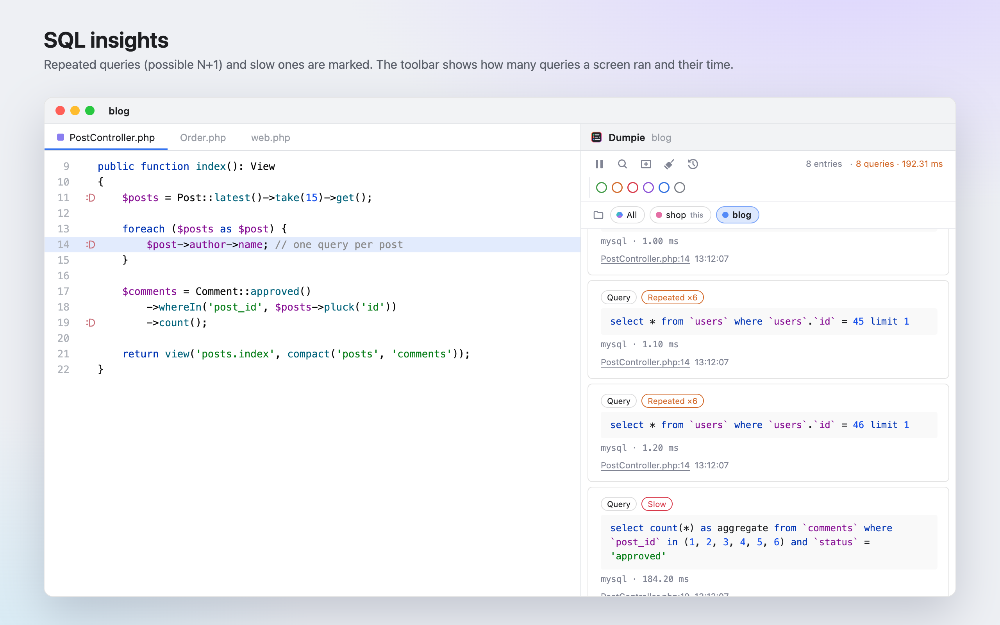

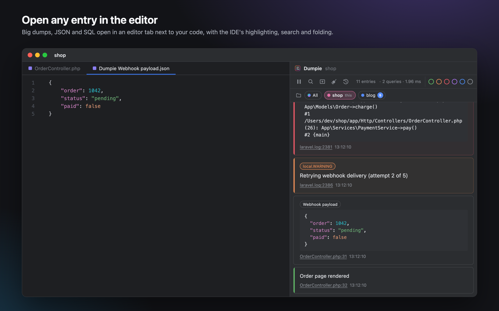

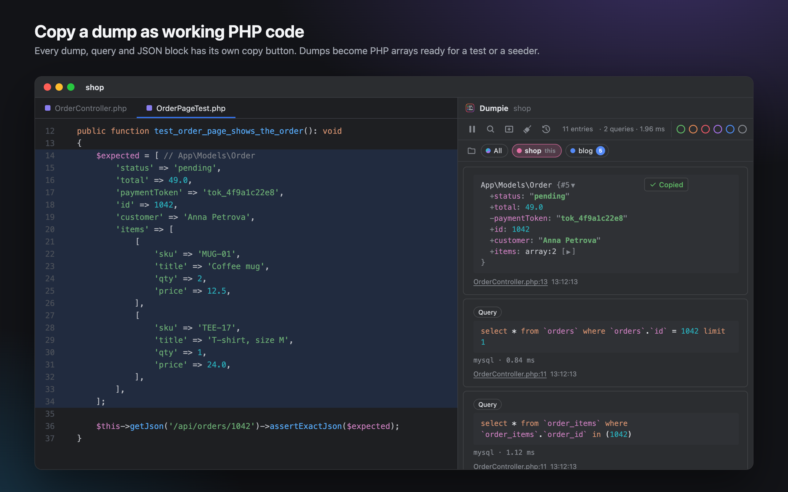

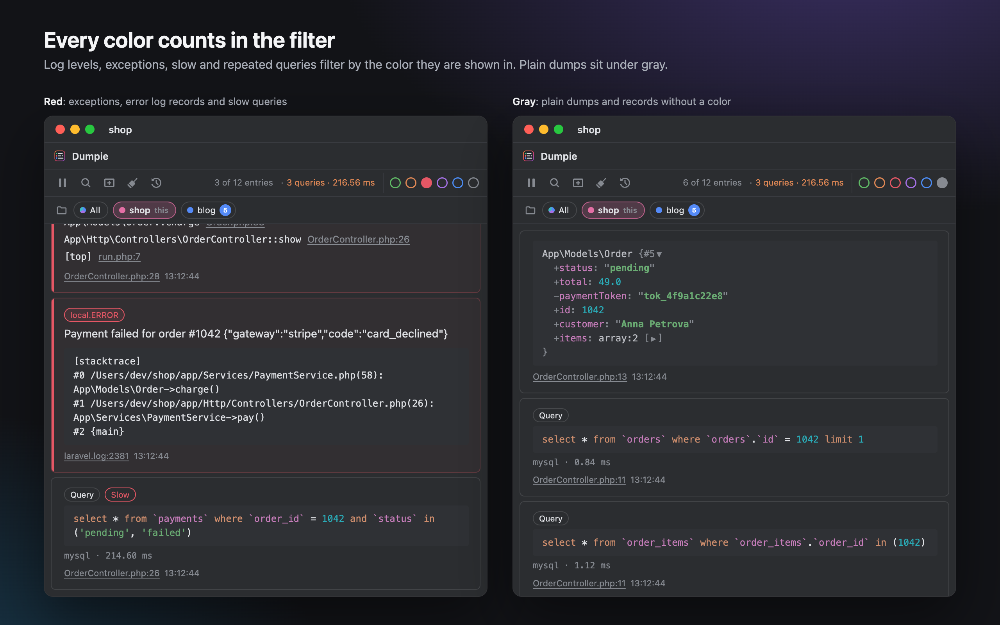

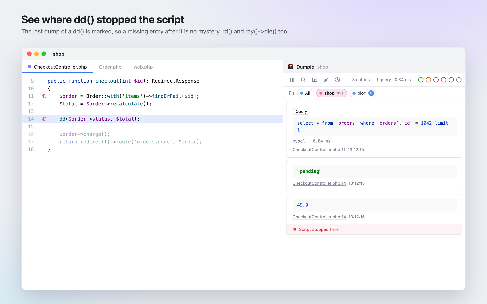

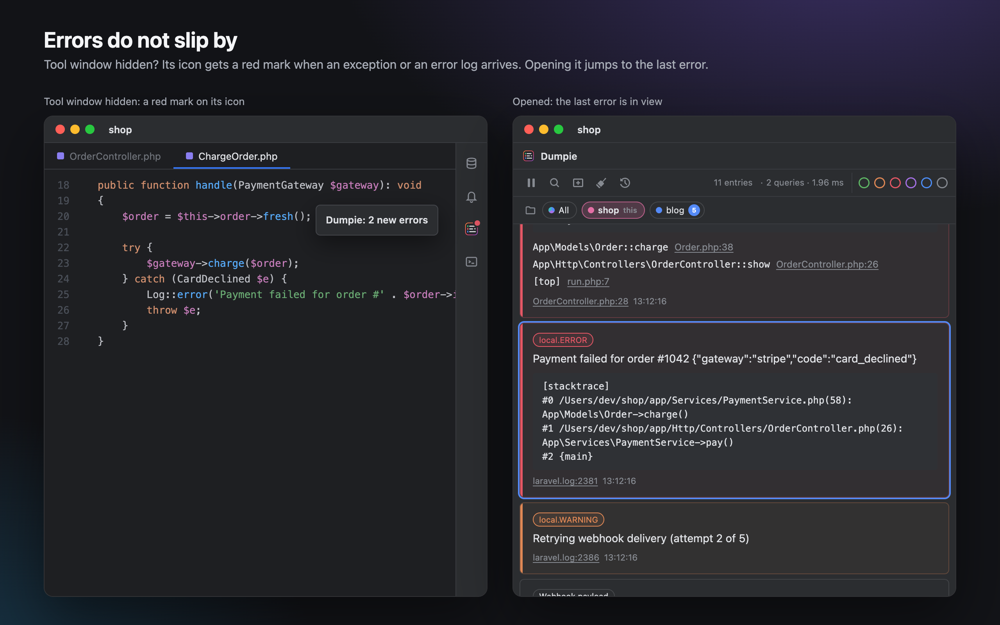

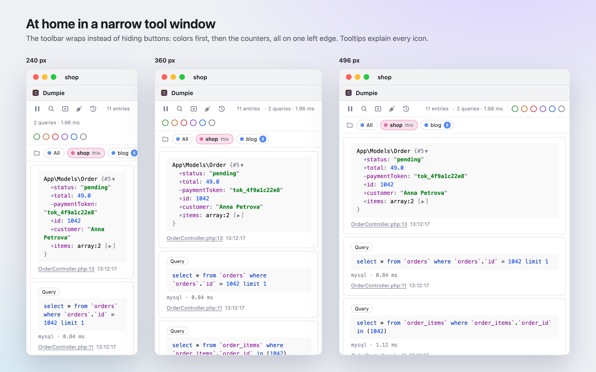

### Keyboard shortcuts

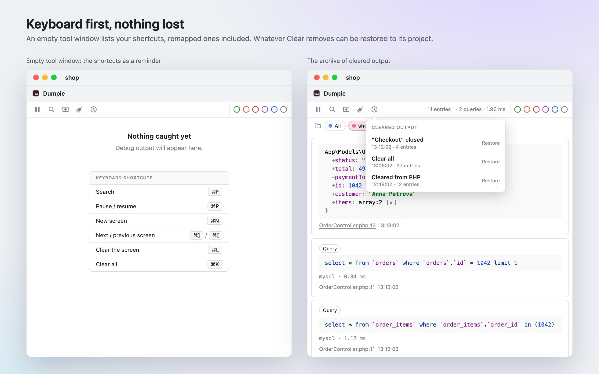

They work while the Dumpie tool window has focus, so ⌘K still commits in the editor. All of them are in
**Tools | Dumpie** and can be remapped in **Settings | Keymap**. The empty tool window lists them as a reminder.

| Action | macOS | Windows / Linux |
|---|---|---|
| Clear all | ⌘K | Ctrl+K |
| Clear the current screen | ⌘L | Ctrl+L |
| New screen | ⌘N | Ctrl+N |
| Pause / resume | ⌘P | Ctrl+P |
| Search | ⌘F | Ctrl+F |
| Next / previous screen | ⌘] / ⌘[ | Ctrl+] / Ctrl+[ |

## Settings

Open **Settings | Tools | Dumpie**. The page has four groups:

- **Receivers**, **Display** and **SQL queries** apply to every project in the IDE. They are stored in `dumpie.xml`
  in the IDE configuration directory.
- **This project** applies to the open project only. It is stored in `.idea/workspace.xml`, so it is not shared
  through version control.

**Apply** takes effect right away: the receivers and the log watcher restart and open tool windows pick up the new
options. No IDE restart is needed.

### Receivers (all projects)

Dumpie listens on `127.0.0.1` only. When a port is taken, it retries every 5 seconds and shows a warning if another
application holds the port. Another IDE running Dumpie does not count: in that case the IDE that owns the ports
forwards output to the others.

| Setting | Default | What it does |
|---|---|---|
| **spatie/ray clients, port** | On, `23517` | Receives `ray()` calls over HTTP. Change the port when another application uses `23517` (for example the Ray desktop app), and point the project at it: `RAY_PORT` for `spatie/laravel-ray`, `'port'` in `ray.php` for `spatie/ray`. |
| **dump() / dd() via VarDumper server, port** | On, `9912` | Receives `dump()` and `dd()` from Symfony VarDumper in server mode. The project sends to it with `VAR_DUMPER_FORMAT=server` and `VAR_DUMPER_SERVER=127.0.0.1:<port>`. |

### Display

| Setting | Default | What it does |
|---|---|---|
| **Show the tool window when output arrives** | On | Opens the Dumpie tool window on new output. Turn it off to keep the window closed while you work and rely on the error mark below. |
| **Keep the project and screen bars visible while scrolling** | On | The project chips and screen tabs stay under the toolbar. Off: they scroll away with the feed and leave more room for entries. |
| **Use the editor background (white) in light themes** | On | In light themes the feed uses the editor's background. Off: the tool window background. Dark themes are not affected. |
| **Show an icon in the editor gutter on lines that produced output** | On | Marks lines that sent output with an icon. Hover it to see what the line sent, click it to jump to the entry. Turning it off also removes the icons already shown. |
| **Mark the tool window icon when errors arrive while it is hidden** | On | Exceptions and log records of level error, critical, alert or emergency put a red mark on the tool window icon; its tooltip counts them. Showing the tool window clears the mark and scrolls to the last error. |
| **Treat entries without a color as gray in the color filter** | On | The gray dot also finds entries that have no color: plain `dump()` output, info log records, `ray()` calls without a color. Off: gray finds only `ray()->gray()` and debug log records. |

### SQL queries

| Setting | Default | What it does |
|---|---|---|
| **Show the number of queries and their total time in the toolbar** | On | Shows `12 queries · 48.20 ms` for the current screen. The numbers turn orange when the screen has repeated or slow queries. |
| **Mark repeated queries (possible N+1)** | On | The same statement with other values that ran 3 or more times on one screen is marked **Repeated**. Such queries are found by the orange filter. |
| **Mark queries slower than … ms** | On, `100` | Queries that took longer are marked **Slow** and found by the red filter. Any value from 1 to 600000 ms. |

### This project

Dumpie inspects a project the first time it is opened and fills this group from `composer.lock`, `.env` and the log
directories. After that your changes are kept; **Detect Again** repeats the inspection.

| Setting | Default | What it does |
|---|---|---|
| **ray() output** | On | Shows `ray()` output that belongs to this project. The note under it says whether `spatie/ray` or `spatie/laravel-ray` was found in `composer.lock`; a global install works too. |
| **dump() output** | On if `symfony/var-dumper` is in `composer.lock` | Shows `dump()` and `dd()` output of this project. The note says whether `VAR_DUMPER_FORMAT` is already set in `.env`. |
| **Add to .env** | Shown when it is needed | Appears when the project has VarDumper but `.env` does not send dumps yet. Adds `VAR_DUMPER_FORMAT=server` and `VAR_DUMPER_SERVER` (`host.docker.internal` for Laravel Sail projects); an existing key is updated, never added twice. |
| **Log files** | On if `storage/logs` or `var/log` exists | Follows the project's log files and shows every new record with its stack trace. Expects the Monolog line format (`[2026-10-26 12:00:00] local.ERROR: message`), the default in Laravel and Symfony. Only records written after the project was opened are shown. |
| **Log file patterns** | `storage/logs/*.log` or `var/log/*.log` | Which files to follow: glob patterns relative to the project root, one per line. Wildcards are allowed in the file name only, for example `storage/logs/*.log` or `storage/logs/worker-*.log`. |
| **Detect Again** | | Inspects the project again and overwrites **dump() output**, **Log files** and the log patterns with what it finds. |

Log records are colored by level: emergency, alert, critical and error in red, warning in orange, notice in blue, debug
in gray. Info records have no color.

### Remapping the shortcuts

The shortcuts of the tool window are actions in **Tools | Dumpie** and can be remapped in **Settings | Keymap**
(search for "Dumpie"). See [Keyboard shortcuts](#keyboard-shortcuts) for the defaults.

## Troubleshooting

- **`ray()` calls do not show up, but dumps and logs do**: the Ray desktop app is probably running and holds port
  `23517`. Quit Ray, or move Dumpie to another port as described in
  [Keeping Ray and Dumpie side by side](#projects-with-spatieray).
- **"Port … is used by another application"**: another tool listens on that port, typically the Ray desktop app,
  `php artisan dump-server` or `bin/console server:dump`. Stop it or change the port in the settings (and in
  `VAR_DUMPER_SERVER` / `RAY_PORT` of the project).
- **Dumps still show up in the browser**: PHP does not see `VAR_DUMPER_FORMAT`. Check `.env`, the cached Laravel
  configuration and, for Docker, `VAR_DUMPER_SERVER`.
- **The tool window stays empty**: make sure a project is open in the IDE (receivers start with the first project)
  and that the source is enabled under **This project**.

Still stuck? [Open an issue](https://github.com/sadonsergey/dumpie/issues) and describe your setup.

## Building from source

Requirements: JDK 21 or newer.

```bash
./gradlew buildPlugin   # build/distributions/dumpie-<version>.zip
./gradlew runIde        # starts a sandbox IDE with the plugin installed
./gradlew test          # unit, IDE and browser tests (the first run downloads headless Chromium)
```

By default the build downloads PhpStorm (`platformVersion` in `gradle.properties`). To use an installed IDE instead,
create a `local.properties` file (it is not committed):

```properties
platformLocalPath=/Applications/PhpStorm.app
```

## Contributing

Dumpie is a young project, and I am always happy to make it better. Ideas, bug reports and code are all welcome:

- **Found a bug or have an idea?** [Open an issue](https://github.com/sadonsergey/dumpie/issues). Include your IDE
  version, PHP framework and, if possible, the code that produced the output.
- **Want to change something yourself?** Fork the repository and send a pull request. Small focused changes are the
  easiest to review; for bigger ones, start with an issue so we can agree on the approach.
- **Built something on top of Dumpie?** Forks are welcome too. Keep the license notice, and feel free to share what
  you made.

## Support the project

Dumpie is free and will stay free. If it saves you time:

- **Leave a review** on [JetBrains Marketplace](https://plugins.jetbrains.com/plugin/35423-dumpie/reviews). It helps other PHP developers find Dumpie and tells me what
  to build next.
- **Star the repository** on GitHub: it makes the project easier to find.
- **Donate** on [Boosty](https://boosty.to/sadonsergey/donate) to support its development.

## License

Dumpie is free and open source software under the [MIT License](LICENSE).

In plain words:

- **You can** use Dumpie for free, for personal and commercial work, read and change its code, fork it and
  distribute your own versions.
- **You must** keep the copyright notice and the license text in copies and substantial parts of the code.
- **No warranty**: the software is provided as is, without any guarantees; the author is not liable for any damage
  arising from its use.

The [LICENSE](LICENSE) file is the legally binding text; this summary is for convenience only.

Dumpie is an independent project, not affiliated with or endorsed by Spatie. Ray and spatie/ray are products of Spatie.

---

<p align="center">Built by a developer for developers, with love</p>
